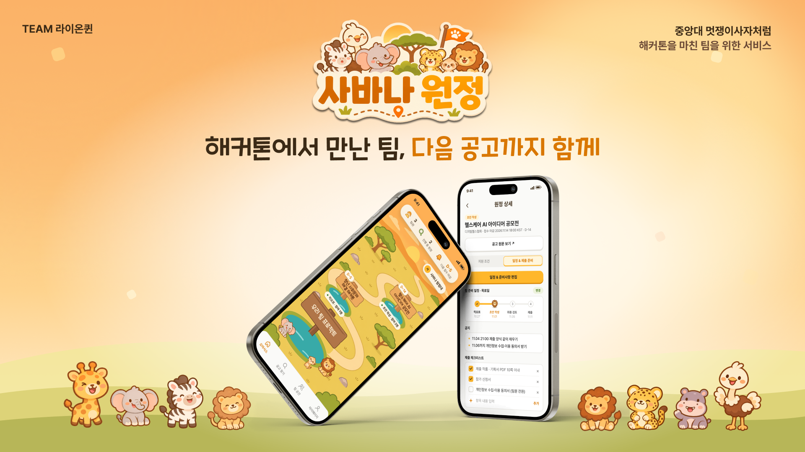

# 🦁 사바나 원정

기존 프로젝트에 맞는 공고를 찾고, 함께할 팀원을 확인하며, 다음 도전을 준비하는 서비스

**서비스 주소 :** https://savanna-expedition.vercel.app



<br>

## 📌 서비스 소개

해커톤이 끝나면 함께 만든 프로젝트와 팀은 자연스럽게 흩어집니다.
사바나 원정은 기존 프로젝트에 맞는 공고를 찾고, 함께할 팀원을 확인하며, 다음 도전을 준비하는 과정을 한곳에 모았습니다.

서비스 안에서는 팀을 **사자 무리**, 팀이 참여하는 공고를 **물웅덩이**, 진행 중인 공고를 모아 보는 공간을 **오아시스**로 표현합니다.

### 해결하려는 문제

- **다음 도전이 시작되지 않습니다.** 다음 공고를 찾아 공유하는 일이 누군가의 몫으로 남아, 공고만 찾아두고 흐지부지되기 쉽습니다.
- **공고 하나를 고르는 데도 확인할 것이 많습니다.** 공모 주제, 참가 대상과 인원, 마감 일정까지 팀이 직접 따져봐야 합니다.
- **준비 상황이 여러 곳에 흩어집니다.** 목표일, 공지, 제출 준비가 대화방과 문서에 나뉘어 있습니다.

### 해결 방법

| 기존 방식 | 사바나 원정 |
|---|---|
| 팀원이 직접 공고를 찾아 공유 | 프로젝트 기반 공고 추천과 추천 이유 |
| 대화방에서 참여 의사를 하나씩 확인 | 공고별 참여 제안과 합류 / 쉬어가기 응답 |
| 참여 인원을 모아 조건을 직접 대조 | 실제 합류자 기준 참가 조건 확인 |
| 준비 내용이 대화·문서에 분산 | 원정별 목표일, 공지, 제출 체크리스트 |

<br>

## ✨ 주요 기능

**공고 찾기**
- 팀 프로젝트 정보를 바탕으로 AI가 공고를 추천하고, 추천 이유를 함께 보여줍니다.
- 검색과 분야·접수 상태 필터로 전체 공고를 찾을 수 있습니다.
- 공고 상세에서 접수 일정, 참가 조건, 지원 방법을 확인합니다.

**참여 제안과 응답**
- 마음에 드는 공고를 팀원들에게 한 번에 제안합니다.
- 받은 제안에 "합류하기" 또는 "이번엔 쉬어가기"로 응답합니다.
- 보낸 제안의 합류, 쉬어가기, 미응답 현황을 한눈에 확인합니다.

**오아시스와 원정 상세**
- 팀이 참여 중인 공고(원정)를 지도 위 표지판과 D-day로 모아 봅니다.
- 원정 상세에서 진행 단계, 목표일, 팀 공지를 관리합니다.
- 제출 체크리스트로 제출 준비를 함께 챙깁니다.

**팀과 계정**
- 구글 로그인 후 캐릭터, 학적, 참석 가능 지역을 입력합니다.
- 팀을 만들고 초대 링크로 팀원을 모읍니다.
- 마이페이지에서 내 정보를 수정합니다.

### 사용 흐름

구글 로그인 → 내 정보 입력 → 팀 생성·합류 → 공고 찾기 → 참여 제안 → 오아시스에서 원정 준비

<br>

## 🛠️ 기술 스택

| 구분 | 기술 |
|---|---|
| Frontend | React, TypeScript |
| Build Tool | Vite |
| Styling | styled-components |
| Routing | React Router |
| HTTP Client | Axios |
| Linter | Oxlint |
| Deploy | Vercel |

<br>

## 📁 폴더 구조

```
src/
├── api/              # 도메인별 API 함수와 응답 타입
├── assets/           # 폰트, 아이콘, 이미지, 캐릭터 리소스
├── components/
│   ├── common/       # 공용 UI 컴포넌트
│   ├── layout/       # AppBar, TabBar
│   ├── onboarding/   # 로그인 · 내 정보 입력 · 초대
│   ├── team/         # 팀 생성 · 팀 공간 · 팀 소식
│   ├── contest-search/  # 공고 찾기 · 공고 상세 · 참여 제안
│   ├── oasis/        # 오아시스 지도 · 원정 상세 · 일정 편집
│   └── toast/        # 토스트 알림
├── pages/            # 라우트 단위 페이지
├── routes/           
├── types/            
├── utils/            # 날짜 · D-day · 지역 변환 등 공통 함수         
```

<br>

## 🌐 배포

- Vercel로 배포합니다.
- 모바일 웹 기준으로 제작했으며, 태블릿과 노트북에서는 402×874 모바일 화면 프레임으로 표시됩니다.
- Safari의 서드파티 쿠키 차단으로 로그인이 풀리는 문제를 막기 위해, `/api`, `/oauth2`, `/login/oauth2` 요청은 `vercel.json`의 rewrites로 같은 도메인에서 백엔드로 전달합니다.

<br>

## 🚀 실행 방법

```bash
git clone https://github.com/LikeLion-14th-CAUkathon/savanna-frontend.git
cd savanna-frontend
git switch develop
npm install
npm run dev
```

개발 서버 주소: http://localhost:5173/

| 명령어 | 설명 |
|---|---|
| `npm run dev` | 개발 서버 실행 |
| `npm run build` | 타입 검사 후 배포용 빌드 |
| `npm run lint` | Oxlint 코드 검사 |
| `npm run size` | JS 번들 크기 검사 (170 kB 이하) |

<br>

## 🤝 협업 규칙

- **브랜치**: `main` 배포, `develop` 개발 통합, `feature/*` 기능, `fix/*` 버그 수정, `design/*` UI 수정, `chore/*` 환경 설정
- **커밋**: `태그: 작업 내용` 형식 (`feat`, `fix`, `design`, `refactor`, `docs`, `chore`)
- **진행 순서**: Issue 생성 → 브랜치 생성 → `develop` 대상 PR → 코드 리뷰 → Merge

<br>

## 👥 팀원 (TEAM 라이온 퀸🦁👑)

| 역할 | 이름 |
|---|---|
| PM | 김지연 |
| Design | 오채린, 윤아영 |
| Frontend | 김지수, 소재희, 안서현 |
| Backend | 김예은, 김주연 |
